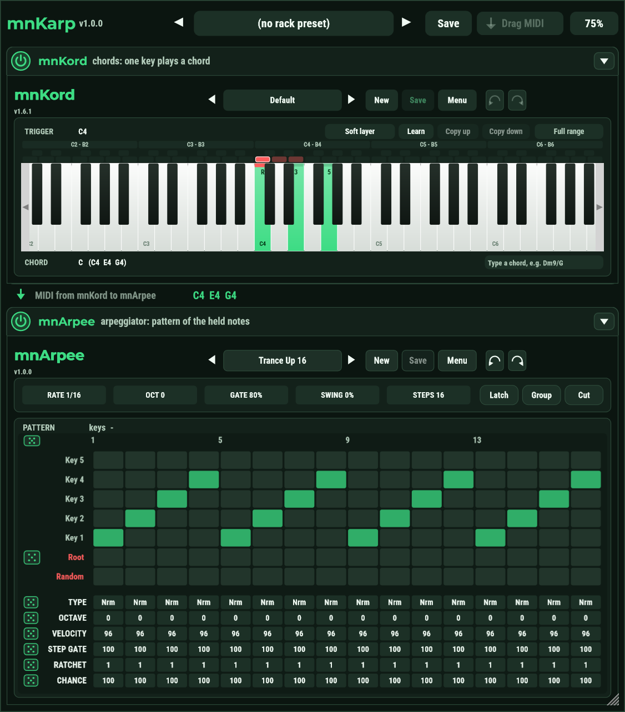

# mnKarp felhasználói útmutató

[English](USER_GUIDE.md) · **Magyar**

Az mnKarp két MIDI-effekt egy pluginban, rack-szerűen: felül az **mnKord** (egy billentyű egy akkordot szólaltat meg), alatta az
**mnArpee** (a hangokat mintában játssza le). A MIDI előbb az mnKordon, aztán az mnArpee-n megy át, és mindkettő kikapcsolható.

```
MIDI be -> [ mnKord ] -> [ mnArpee ] -> MIDI ki
              be/ki         be/ki
```

A két ablak az mnKord és az mnArpee, ezért az útmutatóik (mintarács, presetböngésző, akkordszimbólumok, skálák, Undo / Redo)
itt is érvényesek. Egy dolog más: a rackben az mnKordnak **egy billentyűzete** van az INPUT és a CHORD billentyűzet helyett (lásd
lent). Ez az útmutató azt írja le, amit a rack hozzátesz.

## Telepítés

Futtasd az `mnKarp-<verzió>-win-x64-setup.exe` fájlt. A VST3 a `Common Files\VST3\MNAudio\mnKarp.vst3` mappába kerül, amelyet minden
DAW átnéz, ez az útmutató pedig a `Program Files\MNAudio\mnKarp` mappába. Zárd be előtte a DAW-ot, ha be van töltve az mnKarp.
Az mnKordot és az mnArpee-t nem kell telepítened: az mnKarp mindkettőt tartalmazza. Ha megvannak, a három egymás mellett működik,
és közösen használják a presetkönyvtárakat.

## Használat DAW-ban

Az mnKarpot **hangszersávra** tedd, mint az mnKordot vagy az mnArpee-t. A sáv MIDI-jét kapja, és a MIDI-jét adja tovább a következő
eszköznek, egy szintinek vagy samplernek. Hangot nem ad.

## Az ablak



Fentről lefelé:

- **A felső sáv.** A cím és a verzió, középen a rack presetek, jobbra a **Drag MIDI** és a méret gomb.
- **Az mnKord szekció.** Egy sáv a kapcsolóval, a névvel és az összecsukó nyíllal, alatta az mnKord ablaka.
- **A hangsor.** Azok a hangok, amelyeket az mnKord átad az mnArpee-nak, élőben: billentyű lenyomásakor itt látod az akkordot. Gyorsan
  megmutatja, mit csinál az első fokozat.
- **Az mnArpee szekció.** A sávja és az mnArpee ablaka.

### Az mnKord billentyűzete

A rackben az mnKordnak egy billentyűzete van, közvetlenül fölötte egy **trigger-sávval**:

- **A trigger-sávban** minden billentyű fölött van egy kis cella (a fekete billentyűké a sáv felső felében, a fehéreké az alsóban).
  Egy cellára kattintva azt a billentyűt választod **triggernek**: ezt kell lenyomnod az akkordhoz. Jobb klikkre az akkordsablonok
  jönnek elő. Az akkorddal már rendelkező billentyűk cellája halványpiros, a kiválasztotté élénkpiros, fehér kerettel. Ha skála van
  kiválasztva, csak a skála hangjainak van cellája.
- **A billentyűk** a kiválasztott trigger akkordját szerkesztik: kattintásra hozzáadják vagy elveszik az akkordhangot, egy
  akkordhangot fel-le húzva a velocityjét állítod, jobb klikkre megfordíthatod az akkordot.

| Szín | Jelentés |
|------|----------|
| zöld billentyű | a kiválasztott akkord hangja (a fokával: R, 3, 5, ...) |
| piros billentyű | a kiválasztott trigger (piros sáv a tetején, ha akkordhang is) |
| piros sáv a billentyű tetején | a kontrolleren éppen lenyomott billentyű |
| narancs sáv a billentyű alján | szóló akkordhang |

A sáv fölötti sorban a trigger neve, a velocity réteg, a Learn, a Copy up / down és a skála van; a billentyűk alatti sorban az
akkord neve és az akkordszimbólum mezője.

### Fokozat kikapcsolása

A sáv bal szélén lévő kerek **kapcsolóval** ki- és bekapcsolhatod a fokozatot. A kikapcsolt fokozat nem csinál semmit: a MIDI
érintetlenül átmegy rajta. Az ablaka halvány, a sávban az "OFF - the MIDI passes through" felirat látszik, és szerkeszthető marad.

| mnKord | mnArpee | Amit kapsz |
|--------|---------|------------|
| be | be | a billentyű akkordot szólaltat meg, az akkordot pedig mintában játssza |
| be | ki | a billentyű akkordot szólaltat meg |
| ki | be | a lenyomott billentyűket mintában játssza |
| ki | ki | a MIDI változatlanul átmegy |

A kapcsolók host-paraméterek (`mnKord On`, `mnArpee On`), ezért automatizálhatók, vagy kontrollerre köthetők. Amikor egy fokozatot
kikapcsolsz, felengedi, amit éppen szólaltat (az akkordot, az arpeggiót), így nem ragad be hang.

### Ablak összecsukása

A sáv jobb szélén lévő nyíl elrejti a fokozat ablakát (és újra megmutatja). A hangzást nem érinti. Hasznos, hogy a rack alacsonyabb
legyen, amíg a másik fokozaton dolgozol. A projekt megjegyzi, mi van összecsukva.

### Méret és szélesség

A felső sáv **méret gombja** (kezdetben 75%) a két ablak méretét együtt állítja, 60% és 115% között. 75%-on a rack kb. 950 képpont
magas; ha nem fér el a képernyőn, válassz kisebbet.

A két ablak **mindig egyforma széles**. Az mnArpee ablaka átméretezhető a jobb alsó sarkával, és az mnKord ablaka követi, meg
fordítva. A méretet és a szélességet a projekt megjegyzi.

## Rack presetek

Egy rack preset az **mnKord és az mnArpee jelenlegi presetjét** és a **két kapcsolót** tárolja egy név alatt, így egy egész hang
("Pop akkordok 16-od arpeggióval") egy kattintással visszajön. Az ablak méretét nem tartalmazza.

A felső sávban:

- a nyilak az előző és a következő presetre lépnek;
- a név megnyitja a menüt: a presetek listája (a jelenlegi pipával), **Save**, **Save as...**, **Revert to saved**, **Delete...** és
  **Show the preset folder**;
- a **Save** a jelenlegi presetet írja ki; ha a projektnek még nincs, nevet kér. Foglalt névnél rákérdez, mielőtt felülírná.

A név bal oldalán lévő zöld pötty azt jelzi, hogy a rack változott a preset betöltése vagy mentése óta (egy kapcsoló, vagy a két plugin
valamelyikének presetje vagy értéke; a méret nem számít). Ilyenkor másik preset választásakor előbb rákérdez: **Save**, **Discard** vagy
**Cancel**. A kérdések a plugin ablakán belül jelennek meg.

A presetek fájlok (`.mnkarp`) a `Documents\MNAudio\mnKarp\Presets` mappában, minden projekt és minden mnKarp példány közösen
használja őket. Másik gépre másolással vihetők át. A rack preset a két preset *tartalmát* tárolja, ezért akkor is ugyanúgy szól, ha
később átszerkeszted a presetet az mnKord vagy az mnArpee könyvtárában. A Delete a fájlt a lomtárba teszi.

Az mnKarppal mentett projekt mindkét fokozat teljes állapotát megtartja, akár van kiválasztott rack preset, akár nincs.

## Hol vannak a fájlok

| Mi | Hol |
|----|-----|
| A plugin | `C:\Program Files\Common Files\VST3\MNAudio\mnKarp.vst3` |
| Rack presetek | `Documents\MNAudio\mnKarp\Presets` |
| mnKord presetek | `Documents\MNAudio\mnKord` (ugyanaz, mint az mnKord sajátja) |
| mnArpee presetek | `Documents\MNAudio\mnArpee` (ugyanaz, mint az mnArpee sajátja) |

## Drag MIDI: a végeredmény klipként

Az mnKarp megjegyzi, amit az utolsó 10 percben kiküldött. A felső sáv **Drag MIDI** gombja az **utolsó részt** adja át a DAW-nak: húzd a
gombot egy sávra (vagy az arrangerbe), és a hangok MIDI-klipként odakerülnek. Kattintásra `.mid` fájlba menti.

- Az utolsó rész a legutóbbi játék: az első hanggal kezdődik, amely előtt legalább 2 másodpercig semmi sem szólt (vagy ahol a DAW
  loopja visszaugrott), és az utolsó hangig tart.
- Ha a DAW transzportja fut, a klip az első hang ütemének elején kezdődik, így arra az ütemre ejtve a helyén lesz. Transzport nélkül
  az első hanggal kezdődik.
- A fájlban benne van a tempó is; negyedenként 960 tick.
- Amíg nincs mit áthúzni, a gomb szürke.

## A DAW-ban: automatizálás és programlista

**Paraméterek.** A host a rack következő paramétereit látja, ezeket automatizálhatod, felveheted, és kontrollerre is kötheted:

| Paraméter | Mi ez |
|-----------|-------|
| `mnKord On`, `mnArpee On` | a két kapcsoló |
| `mnArpee Rate`, `Octave`, `Gate %`, `Swing %`, `Steps` | az mnArpee fejlécének értékei |
| `mnArpee Latch`, `Group octaves`, `Cut on release` | az mnArpee három kapcsolója |

Ezek az mnArpee ablakának saját vezérlői: ha az ablakban megmozdítasz egyet, a host felveszi, ha a hostban automatizálsz egyet, a
vezérlő követi. Az mnKordnak nincs saját paramétere.

**Presetek a DAW-ból.** A host preset-(program-)listája a **rack presetek** listája, a legrégebbitől kezdve, így az új preset a végére
kerül, és a DAW által eltárolt számok jelentése nem változik. Mindig 128 hely van, az üresek neve "-". A DAW-ban egy program
kiválasztása betölti a rack presetet, ahogy a név menü is. A mappába másolt presetfájl a menü megnyitásakor (vagy amikor a DAW újra
lekérdezi) megjelenik.

A fokozatok sorrendje fix: előbb az mnKord, aztán az mnArpee.

## Kérdések

**Nem szól semmi, ha megnyomok egy billentyűt.** Nézd meg, hogy a sáv hangszersáv-e, és hogy az mnKarp utáni szinti kap-e tőle MIDI-t.
Ellenőrizd a két kapcsolót, és hogy az mnKordban van-e kiosztás a billentyűre (lásd az útmutatóját).

**A rack magasabb a képernyőmnél.** Válassz kisebb méretet a méret gombbal, vagy csukd össze a nem használt ablakot.

**Lenyomott billentyű mellett kikapcsoltam egy fokozatot, és most a billentyű néma.** A lenyomott billentyűt felengedte a fokozattal
együtt. Nyomd meg újra.

**Kiváltja az mnKordot és az mnArpee-t?** Nem: azok változatlanul megmaradnak, az mnKarp ugyanazt a kódot használja. Ha csak
akkordkiosztót vagy csak arpeggiátort szeretnél, használd őket külön.

## Licenc

Az mnKarp szabad szoftver az AGPL-3.0 alatt, mint az mnKord és az mnArpee. Vibecoder: Németh Miklós.
