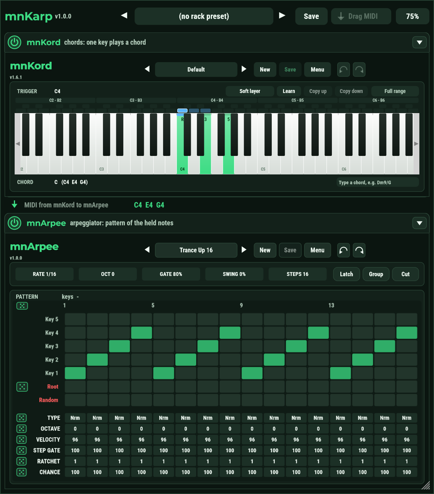

# mnKarp user guide

**English** · [Magyar](USER_GUIDE.hu.md)

mnKarp is a rack of two MIDI effects in one plugin: **mnKord** (one key plays a chord) above **mnArpee** (the notes are
played as a pattern). The MIDI goes through mnKord first and then through mnArpee, and each of the two can be switched off.

```
MIDI in -> [ mnKord ] -> [ mnArpee ] -> MIDI out
              on/off        on/off
```

The two windows are mnKord and mnArpee, so their user guides (the pattern grid, the preset browsers, chord symbols, scales,
Undo / Redo) apply here too. One thing is different: mnKord has **one keyboard** in the rack instead of the INPUT and CHORD
keyboards (see below). This guide is about what the rack adds.

## Installing

Run `mnKarp-<version>-win-x64-setup.exe`. It installs the VST3 to `Common Files\VST3\MNAudio\mnKarp.vst3`, which every DAW
scans, and this guide to `Program Files\MNAudio\mnKarp`. Close your DAW first if it has mnKarp loaded. mnKord and mnArpee
do not have to be installed: mnKarp has both inside. If you have them, the three work side by side and share their preset
libraries.

## Using it in a DAW

Put mnKarp on an **instrument track**, as you would mnKord or mnArpee. It receives the MIDI of the track and sends its MIDI to
the next device, a synth or a sampler. It makes no sound itself.

## The window



From top to bottom:

- **The top bar.** The title and the version, the rack presets in the middle, then **Drag MIDI** and the size button at the right.
- **The mnKord section.** A strip with the power switch, the name and the fold arrow, and under it mnKord's window.
- **The note line.** The notes that mnKord gives to mnArpee, live: when you press a key you see the chord here. It is a quick way to
  hear with your eyes what the first stage does.
- **The mnArpee section.** Its strip and mnArpee's window.

### mnKord's keyboard

In the rack mnKord has a single keyboard, with a **trigger lane** right above the keys:

- **The trigger lane** has a small cell over every key (the black keys' cells in its upper half, the white keys' in the lower half).
  Click a cell to choose that key as the **trigger key**: the key you play to get the chord. Right-click it for the chord templates.
  Keys that already have a chord have a pale blue cell; the selected one is bright blue with a white frame. With a scale chosen, only
  the keys of the scale have a cell.
- **The keys** edit the chord of the selected trigger key: click a key to add or remove that chord note, drag a chord note up or down
  to set its velocity, right-click to invert the chord.

| Colour | Means |
|--------|-------|
| green key | a note of the selected chord (with its degree: R, 3, 5, ...) |
| blue key | the selected trigger key (a blue band on top when it is also a chord note) |
| blue band at the top of a key | a key you are playing on your controller |
| orange band at the bottom of a key | a chord note that is sounding |

The row above the lane has the trigger key's name, the velocity layer, Learn, Copy up / down and the scale; the row under the keys
the chord's name and the field for typing a chord symbol.

### Switching a stage off

The round **power switch** at the left of a strip switches the stage off or on. A stage that is off does nothing: the MIDI goes
through it untouched. Its window is dimmed, with the words "OFF - the MIDI passes through" in the strip, and can still be edited.

| mnKord | mnArpee | What you get |
|--------|---------|--------------|
| on | on | a key plays a chord, and the chord is played as a pattern |
| on | off | a key plays a chord |
| off | on | the keys you hold are played as a pattern |
| off | off | the MIDI goes through as it is |

The switches are host parameters named `mnKord On` and `mnArpee On`, so you can automate them or put them on a controller.
When a stage is switched off, what it is sounding (the chord, the arpeggio) is released, so no note hangs.

### Folding a window

The arrow at the right end of a strip hides the stage's window (and shows it again). It does not change the sound. It is useful
to make the rack shorter while you work on the other stage. The project remembers what is folded.

### Size and width

The **size button** in the top bar (75% to start with) sets the size of both windows together, from 60% to 115%. At 75% the rack is
about 950 pixels high; if it does not fit your screen, choose a smaller size.

The two windows are **always equally wide**. mnArpee's window can be resized with the corner at its bottom right, and mnKord's window
follows it, and the other way round. The size and the width are kept with the project.

## Rack presets

A rack preset holds the **current presets of mnKord and mnArpee** and the **two switches** under one name, so a whole sound
("Pop chords with a 16th arp") comes back with one click. It does not hold the size of the window.

In the top bar:

- the arrows step to the previous and the next preset;
- the name opens the menu: the list of the presets (the current one is ticked), **Save**, **Save as...**, **Revert to saved**,
  **Delete...** and **Show the preset folder**;
- **Save** writes the current preset; when the project has none yet, it asks for a name. A name that is taken asks before it replaces it.

A green dot at the left of the name means the rack has changed since the preset was loaded or saved (a switch, or a preset or a value in
one of the two plugins; the size does not count). Choosing another preset then asks first: **Save**, **Discard** or **Cancel**. The
questions open inside the plugin window.

The presets are files (`.mnkarp`) in `Documents\MNAudio\mnKarp\Presets`, shared by every project and every instance of mnKarp. Copy
them to another computer to take them with you. A rack preset stores the *content* of the two presets, so it plays the same even
if you later edit the preset in the mnKord or mnArpee library. Delete moves the file to the recycle bin.

A project saved with mnKarp keeps the full state of both stages, whether or not a rack preset is selected.

## Where the files are

| What | Where |
|------|-------|
| The plugin | `C:\Program Files\Common Files\VST3\MNAudio\mnKarp.vst3` |
| Rack presets | `Documents\MNAudio\mnKarp\Presets` |
| mnKord presets | `Documents\MNAudio\mnKord` (the same as mnKord's own) |
| mnArpee presets | `Documents\MNAudio\mnArpee` (the same as mnArpee's own) |

## Drag MIDI: the result as a clip

mnKarp keeps what it has sent out in the last 10 minutes. **Drag MIDI** in the top bar hands the **last take** to the DAW: drag the button
onto a track (or the arranger) and the notes land there as a MIDI clip. Click it instead to save the take as a `.mid` file.

- The take is the latest stretch of playing: it starts with the first note after at least 2 seconds in which nothing sounded (or where
  the DAW's loop jumped back) and runs to the last note.
- While the DAW's transport runs, the clip starts on the bar of its first note, so it lands in time when you drop it on that bar. Without
  the transport it starts with its first note.
- The tempo it was played at is in the file; 960 ticks per quarter note.
- The button is grey while there is nothing to drag.

## In the DAW: automation and the program list

**Parameters.** The host sees these parameters of the rack, and you can automate, record and map them to a controller:

| Parameter | What it is |
|-----------|------------|
| `mnKord On`, `mnArpee On` | the two power switches |
| `mnArpee Rate`, `Octave`, `Gate %`, `Swing %`, `Steps` | the values of mnArpee's header |
| `mnArpee Latch`, `Group octaves`, `Cut on release` | mnArpee's three switches |

They are the very controls of mnArpee's window: move one in the window and the host records it, automate one in the host and the
control follows. mnKord has no parameters of its own.

**Presets from the DAW.** The host's preset (program) list is the list of the **rack presets**, oldest first, so a new preset goes to
the end and the numbers a DAW stores keep their meaning. There are always 128 slots; the empty ones are called "-". Choosing a
program in the DAW loads that rack preset, as the name menu does. A preset file copied into the folder shows up when the menu is
opened (or when the DAW asks again).

The order of the stages is fixed: mnKord first, then mnArpee.

## Questions

**Nothing is played when I press a key.** Check that the track is an instrument track and that the synth after mnKarp gets MIDI from it.
Check the two switches, and that mnKord has a mapping for the key (see its guide).

**The rack is taller than my screen.** Choose a smaller size with the size button, or fold the window you are not using.

**I switched a stage off while holding a key, and now the key is silent.** The held key was released with the stage. Press it again.

**Does it replace mnKord and mnArpee?** No: they stay as they are, and mnKarp uses the same code. If you want only a chord
mapper or only an arpeggiator, use them alone.

## License

mnKarp is free software under the AGPL-3.0, like mnKord and mnArpee. Vibecoded by Miklós Németh.
